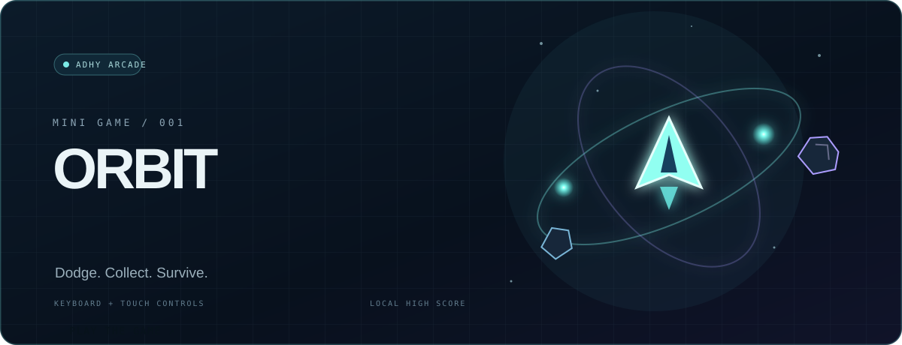

  
  
   
  
  
  

---

## Hey, I'm Adhy.

I'm an Informatics student interested in building useful web applications — from thoughtful interfaces to the application logic behind them. I learn by building, testing the details, and improving what I make.

- **Focus:** full-stack web development and practical software engineering.
- **Interested in:** frontend engineering, UI/UX, API integration, and data-driven applications.
- **Approach:** understand the problem, build a useful solution, refine the experience.

## Explore my space

  
  
<strong>3D scene · Selected projects · Tools · Developer profile</strong>

  <a href="https://nightfall5.github.io/Nightfall5/">Open the interactive portfolio ↗</a>

## Play a little game

  
  
<strong>ORBIT BREAKER</strong> · Dodge asteroids, collect energy, and beat your personal best.

  <a href="https://nightfall5.github.io/Nightfall5/arcade/"><strong>▶ PLAY NOW</strong></a>
   
  Built from scratch with Canvas, JavaScript, keyboard and touch controls. Your high score stays in your browser.

## 3D motion corner

  
  
<strong>A little motion, a lot of curiosity.</strong>

  3D animation asset by <a href="https://github.com/ai-calypse/avatar-studio">AI-Calypse Avatar Studio</a> · MIT License

## Tech stack

  

## Selected projects

| Project | What it demonstrates | Stack |
| --- | --- | --- |
| [**PBP — Neo-Brutalist Login UI**](https://github.com/Nightfall5/pbp-240511056) | Responsive student login interface, input validation, and desktop/mobile implementation. | HTML · CSS · JavaScript |
| [**LUXU — Fragrance Landing Page**](https://github.com/Nightfall5/Landing-Page-Parfume) | Collaborative web project. I led the team and contributed to the responsive landing page, content structure, and interactive details. | HTML · CSS · JavaScript |
| [**LUXU — Marketplace Prototype**](https://github.com/Nightfall5/Luxu_Parfume_Market-Place) | A frontend application prototype exploring a component-based React and TypeScript workflow. | React · TypeScript · Vite · Tailwind CSS |

## GitHub activity

  
  

Statistics reflect public GitHub activity and may take time to refresh.

---

  
<strong>Always learning. Always building.</strong>

  <a href="https://github.com/Nightfall5?tab=repositories">Explore my repositories</a>
    
  

